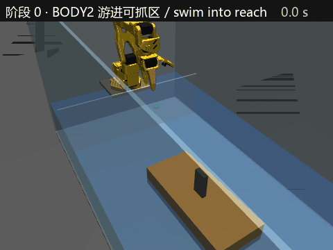

# reset_station：BODY2 复位台（MuJoCo + 强化学习）

机械臂 SO-101 把漂在水槽里的两栖四足机器人 BODY2 夹住、拖到终点、转到指定朝向、松开。先全部在 MuJoCo 里做，用强化学习训练；以后接真机。

*A low-cost SO-101 arm resets a floating amphibious quadruped (BODY2) in a 1 m tank: the robot swims into reach, three SAC skills
(pre-grasp → grasp the mast → drag to the target pose and release) hand over to each other. MuJoCo + Gymnasium + Stable-Baselines3.*

<p align="center"></p>
<p align="center"><sub>完整链路（全部是 SAC，种子 2）：游进可抓区 → 预抓取 → 夹住桅杆 → 拖到终点（绿球）并把船头转向 +x → 松开抬起。
真实速度；用 <code>eval/chain_gif.py</code> 生成。</sub></p>

## 结果（2026-10-22/23）

完整链路 = BODY2 游进可抓区（阶段 0，推力代替游泳）→ 阶段 1 预抓取 → 阶段 2 夹住 → 阶段 3 拖到 (0.24, 0)、船头转向 +x、松开抬起。
`python eval/chain.py ...`，每种 50 回合：

| 阶段 1 / 2 / 3 用的策略 | 静止起点 | 游进来 |
|---|---|---|
| 脚本 / 脚本 / 脚本 | 84 % | — |
| **SAC / SAC / SAC**（阶段 2、3 带 3 万步示范） | 88 % | **98 %** |
| SAC / 残差 SAC（接力起点训练）/ SAC | **96 %** | 94 % |
| SAC / 脚本 / SAC | 98 % | 90 % |

成功回合：总用时约 3–4 s，终点位置误差中位约 10 mm，朝向误差中位 1–2°；松手后 3 s 船还会漂约 4 cm（已知局限，见下）。

单个技能（各自的环境，确定性策略 50 回合）：

| 阶段 | 随机 | 脚本 | SAC |
|---|---|---|---|
| 1 预抓取（TCP 到桅杆上方 + 转腕对准宽面） | 0 % | 100 %，8 步 | 100 %，8 步（10 万步） |
| 2 夹住 | — | 100 %，约 26 步 | 纯 SAC 0 % → 加示范 38 % → **修正奖励后 100 %，17 步**（20 万步） |
| 3 拖动 + 转向 + 松开 | — | 84 %，48 步 | **100 %，36 步**（20 万步，带示范） |

## 这一路上学到的（面试可讲）

- **TCP 要放在真正夹东西的地方**：Menagerie 的 `gripperframe` 在固定指尖前 2 cm 的空中；SO-101 一指固定一指转动，东西总被压在固定指上 → TCP = 固定指内表面 + 桅杆半厚 + 1 mm（`envs/ik.py`）。
- **单侧夹爪 + 漂浮目标**：下降时只要偏向固定指 1 mm 就压在桅杆顶、把船推走 → 夹持点随夹爪开合移动，张开时让桅杆在两指空隙中间（`envs/grasp_env.py::_grip_point`）。
- **奖励漏洞 (reward hacking)**：阶段 2 原来每步给"碰到 +0.5、夹住 +2"，成功只给一次 +20 且结束回合 → 策略学会"一直夹着不完成"。改成每步都 ≤ 0、只有成功为正，SAC 从 38 % 到 100 %。
- **示范 + RL**：夹取靠随机探索碰不上；3 万步脚本示范放进 SAC 回放池后能学会，最终比脚本更快。
- **技能接力的分布偏移**：阶段 2 在"预抓取 + 随机偏差"起点上 96 %，接到阶段 1 的 SAC 后只有 80 % → 一半回合从阶段 1 的真实终点开始训练（`eval/collect_states.py`），链路 96 %。
- **托着船走**：夹着拖时手臂把船压下/提起 1.5 cm，一松手船弹回、被带出 2–7 cm/s → 船的高度偏差进观测和奖励；松手前把"指令 TCP − 实际 TCP"归零。
- **物理仿真的 bug 靠能量检查**：浮船会自己翻 —— 原因是 `mj_objectVelocity(..., 1)` 的"局部系"是惯性主轴系不是 body 系，阻力反而注入能量。

## 已知局限 / 下一步

- 松手后船还会漂 2–7 cm（这个水模型低速阻力很小；真机 BODY2 的腿和尾鳍在水下，阻力应更大，需实测）。
- 阶段 0 进区后用"主动刹车"（反向划水）—— 假设真机能做到，没测过。
- 阶段 3 的起点来自脚本夹取的终点；全 SAC 链路静止起点 88 %，失败都在阶段 3（同样的接力分布偏移，下一步用阶段 2 SAC 的终点重训阶段 3）。
- 每个结果只有 1 个种子；面试报数要补 3 个种子。
- 还没做：观测噪声 / 延迟 / AprilTag 遮挡（阶段 4）、完整水动力、视频录制、蒸馏成单一策略、ACT/SmolVLA。

## 场景（2026-10-20）

- 水槽 1 m × 0.5 m，水深 0.12 m；SO-101 立着装在后墙内侧的平台上，底座比水面高 4 cm。
- 隔板（x = 0.08 m）把机械臂区和船区分开，船进不到平台和底座下面。
- BODY2 先用盒子代替：船体 0.262 × 0.116 × 0.05 m、0.5 kg，中央一根扁桅杆（3 × 1 × 6 cm）给夹爪从上往下夹；转 `wrist_roll` 可让船原地调头。
- 夹爪严格竖直时只能在离底座约 0.30 m 内夹桅杆（`tests/test_ik.py`；`docs/reach_map.png` 允许斜 20°，偏乐观），所以复位分两步：BODY2 自己游进可抓区 → 机械臂夹住、定位、调头。
- 水：`envs/water.py`，体素浮力 + 线性/二次阻力（低保真，系数是先验）。

## 运行

```bash
uv venv .venv --python 3.12
source .venv/bin/activate
uv pip install torch --index-url https://download.pytorch.org/whl/cpu
uv pip install mujoco gymnasium stable-baselines3
python view_scene.py 0
python eval/chain.py reach=sac grasp=sac drag=sac swim view
```

WSL 里 viewer 很卡时：`export GALLIUM_DRIVER=d3d12`（让 OpenGL 走显卡）。

## 文件

| 路径 | 内容 |
|---|---|
| `assets/robotstudio_so101/reset_station.xml` | 场景：水槽、平台、隔板、BODY2 替身、home 初始姿态 |
| `assets/robotstudio_so101/so101.xml` 等 | SO-101 模型，来自 MuJoCo Menagerie（Apache 2.0，见同目录 LICENSE） |
| `envs/water.py` | 浮力和阻力 |
| `envs/ik.py` | 阻尼最小二乘 IK（TCP + 夹爪竖直，关节限位夹紧） |
| `envs/reset_env.py` / `grasp_env.py` / `drag_env.py` | 阶段 1 / 2 / 3 的 Gymnasium 环境 + 各自的脚本策略 |
| `envs/residual.py`、`envs/state_io.py` | 残差 RL 包装器；环境之间传状态（技能接力） |
| `train/train_sac.py`、`train/plot_curves.py` | SAC 训练（可加示范、残差）；画训练曲线 |
| `eval/chain.py`、`eval/chain_frames.py`、`eval/chain_gif.py`、`eval/collect_states.py` | 完整链路评估 / viewer；关键帧截图；GIF；收集接力起点 |
| `results/` | 链路用到的模型（`best_model.zip`）、训练曲线、评估记录、接力起点；检查点和其余模型不进仓库 |
| `tests/` | IK、环境的测试和 viewer |
| `view_scene.py` | 查看场景：BODY2 随机出发、朝可抓区游进来 |
| `docs/` | 截图（`chain_episode.png` 等）、抓取范围图 |
