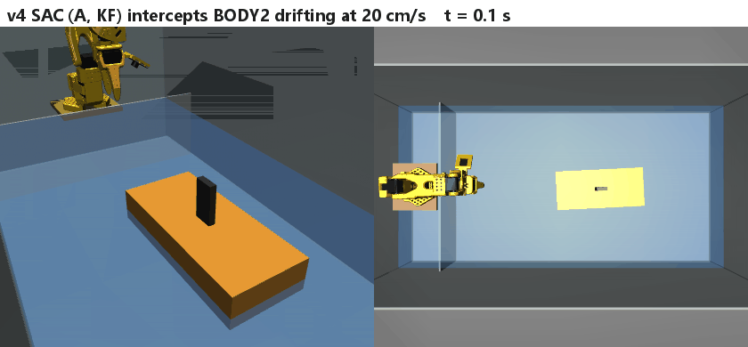
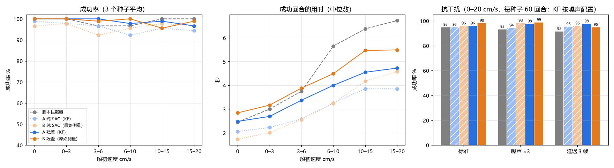
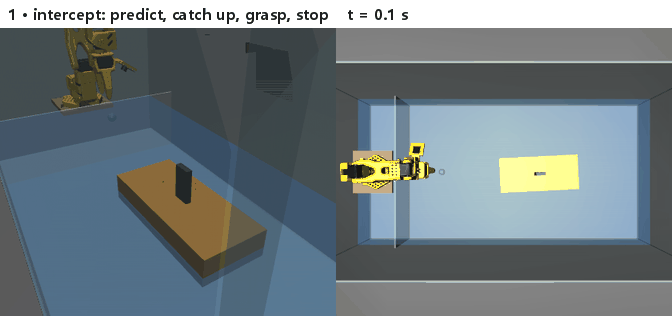

# reset_station

Automatic reset station for **BODY2**, an amphibious quadruped that swims at the water surface. A low-cost **SO-101** arm
(LeRobot) grips a mast on BODY2's hull, drags the robot to a fixed pose in the tank, turns its bow to a set heading and lets
go — so that swimming experiments can run back-to-back without a person resetting the robot by hand.

This repository is the simulation side: a MuJoCo model of the tank, the arm and a stand-in hull, and reinforcement-learning
policies (SAC) for each step of the reset.

自动复位台：SO-101 机械臂夹住两栖四足机器人 BODY2 船体上的桅杆，把它拖到水槽里的固定位置、转到设定朝向后松开，
让游泳实验可以连续进行、不用人手复位。本仓库是仿真部分。另有拦截任务：BODY2 以最高 20 cm/s 漂过来，
机械臂预测轨迹、追上、同速夹住并让船停下（卡尔曼滤波 vs. 原始测量历史两种观测对比）。

<p align="center"></p>
<p align="center"><sub>One full reset, real time (all three skills are SAC policies). BODY2 swims into reach → pre-grasp → grasp the mast →
drag to the target (green) and turn the bow to +x → release.</sub></p>

## Setup

| | |
|---|---|
| Tank | 1.0 × 0.5 m, water depth 0.12 m |
| Arm | SO-101 (5 DoF + gripper, one fixed and one moving jaw), standing on a platform inside the tank, base 4 cm above the water |
| Fence | across the tank at x = 0.08 m, keeps the hull away from the arm base |
| BODY2 stand-in | box hull 262 × 116 × 50 mm, 0.5 kg, floating at its natural draft; flat mast 30 × 10 × 60 mm at the centre, gripped top-down |
| Reach | with the gripper vertical, the mast can be gripped up to about 0.30 m from the arm base, so BODY2 first swims into reach |
| Target pose | hull centre at (0.24, 0) m, bow pointing +x (away from the arm, so BODY2 can swim straight out) |
| Water | voxel buoyancy + linear/quadratic drag per hull axis (`envs/water.py`, low-fidelity, coefficients are priors) |

## Method

The reset is split into skills that hand the full simulator state to each other (`eval/chain.py`):

| Step | Task | Action | Success |
|---|---|---|---|
| 0 | BODY2 swims into reach and brakes | thrust along the bow (stand-in for swimming) | hull at ≤ 0.27 m from the base, speed < 0.5 cm/s |
| 1 Pre-grasp | gripper above the mast, open, jaws across the mast's 10 mm thickness | TCP Δx Δy Δz (±1 cm), wrist roll (±0.1 rad) | horizontal < 1 cm, height < 1.5 cm, roll error < 10° |
| 2 Grasp | descend, close, hold | + gripper (±0.1 rad) | both jaws on the mast, gripper stalled, held 0.5 s, hull pushed < 5 cm |
| 3 Drag | drag to the target pose, turn, release, lift clear | same 5-D action | at release: position < 2 cm, heading < 10°, hull speed < 3 cm/s |

- **Control.** 20 Hz. Position actions move a commanded TCP; a damped-least-squares IK (4 joints, gripper kept vertical,
  joint-limit clamping; `envs/ik.py`) turns it into joint targets for the servo models. Turning the wrist turns the hull 1 : 1.
- **Observation.** Only quantities a real setup can measure: joint angles/velocities (servo feedback), TCP pose, BODY2 pose and
  velocity relative to the target (overhead camera + AprilTag on the hull), gripper command minus position, and in step 3 the hull
  height deviation and commanded-minus-actual TCP.
- **TCP.** Placed where an object is actually clamped: 6 mm from the fixed jaw's inner face (half mast thickness + 1 mm), about
  1 cm above the fingertips. Menagerie's `gripperframe` sits in free space 2 cm in front of the fixed fingertip.
- **Grip point.** With one fixed and one moving jaw, a floating target is pushed away as soon as the fixed jaw touches it. The
  grip point therefore moves with the jaw opening: while open, the mast is centred in the gap; as the jaw closes, the arm brings
  the fixed jaw to the mast (`envs/grasp_env.py::_grip_point`).
- **Rewards.** Dense distance/heading terms; every per-step term is ≤ 0 and only success is positive. (With positive per-step
  bonuses for contact and holding, the policy learned to keep holding without ever completing the grasp.)
- **Training.** SAC (Stable-Baselines3), MLP 256-256, γ = 0.99. Steps 2 and 3 seed the replay buffer with 30 000 transitions from a
  scripted policy (half of them with action noise). Optionally residual RL: action = scripted + 0.3 × SAC (`envs/residual.py`).
  Step 2 can start half of its episodes from states where the step-1 policy actually finished (`eval/collect_states.py`).
- **Carrying the hull.** In step 3 the hull's height deviation is observed and penalised so the arm carries the hull at its natural
  float height; before opening, the arm is unloaded (commanded TCP = actual TCP).

## Results

Full reset chain, 50 episodes each (`python eval/chain.py …`):

| Policies, steps 1 / 2 / 3 | static start | swim-in start |
|---|---|---|
| scripted / scripted / scripted | 84 % | — |
| SAC / SAC / SAC | 88 % | **98 %** |
| SAC / residual SAC (hand-over starts) / SAC | **96 %** | 94 % |
| SAC / scripted / SAC | 98 % | 90 % |

Successful resets take 3–4 s (without swimming in); median final error 10 mm and 1–2°.

Single skills, deterministic policy, 50 episodes:

| Step | random | scripted | SAC |
|---|---|---|---|
| 1 Pre-grasp | 0 % | 100 %, 8 steps | 100 %, 8 steps (100 k steps) |
| 2 Grasp | — | 100 %, ~26 steps | 100 %, 17 steps (200 k steps + 30 k demo steps) |
| 3 Drag | — | 84 %, 48 steps | 100 %, 36 steps (200 k steps + 30 k demo steps) |

Training curves: `results/stage*/…/curves.png`.

## Intercepting a drifting boat

The reset above starts once BODY2 has braked inside reach. The intercept task removes that assumption: BODY2 drifts toward the
grasp zone at up to 20 cm/s (its measured cruising speed is about 0.2 m/s), and the arm has to predict where it goes, catch up,
match its velocity, grasp the mast and bring the hull to rest — ideally before it hits a wall.

<p align="center"></p>

**Environment** (`envs/intercept_env.py`)

- **Spawn.** A target point in the grasp zone (x 0.24–0.29 m — with the gripper vertical the arm reaches about 0.30 m) and an
  approach direction (±50° around +x) are drawn first; the start point is back-computed from speed × 1.5–4 s, so slow boats still
  reach the zone in time. The bow points roughly along the drift (±30°), and the hull starts at least 2 cm from every wall.
- **Arm control.** As in the reset, actions move a commanded TCP and the IK turns it into servo targets, with three changes:
  the servo targets ramp linearly over each 50 ms step instead of jumping, the IK uses a backtracking line search, and the
  commanded TCP is pulled back to what the IK reached when the target is out of reach (anti-windup).
- **Camera.** The policy only sees the overhead-camera measurement: hull position and heading with Gaussian noise
  (1–3 mm, 0.5–1.5°) and one frame (50 ms) of latency.
- **Walls.** A wall hit does not end the episode. Restitution is randomized per episode (contact damping ratio 0.3–1.0, measured
  coefficient of restitution ≈ 0.1–0.6). If the bounce carries BODY2 out of the grasp zone, it swims back (thrust ≤ 0.3 N).
- **Success.** Mast grasped for 0.5 s, hull off the wall, and hull displacement < 1 cm over that 0.5 s.
- **Reward.** All per-step terms ≤ 0: distance and heading to the grip point, finger contacts, −1 per step without a grasp,
  relative velocity near the mast, hull tilt while held, −(2 + 100·v) per wall impact at speed v, −1 per step of pressing the
  held hull against a wall, a penalty for pushing the hull before the grasp, −0.5·|Δa|² for changing the action between steps;
  +20 on success.

**Two ways to give the policy the boat's state**

| | Observation of the boat |
|---|---|
| **A — Kalman filter** (`envs/kalman.py`) | constant-velocity KF estimate: position, velocity, heading, yaw rate, predicted position at 0.25 / 0.5 / 1 s, time to the next wall. An innovation gate (6 σ) re-opens the velocity uncertainty after a bounce. |
| **B — raw history** | the last four noisy, delayed camera measurements; the network has to learn filtering and prediction itself |

Both are trained as SAC (300 k steps, 30 k scripted demo steps, speed curriculum 3 → 20 cm/s), three seeds each
(`results/stage5_intercept/{kf,history}/sac_seed*_demo30000_v4`). Once trained, the network alone controls the arm.

**Results** — 3 seeds × 30 episodes per speed bin, and 3 seeds × 60 episodes per condition at 0–20 cm/s; the KF is configured
for the actual noise level (`eval/intercept_ab.py --kf-tuned`). Jitter = mean |Δa|² between consecutive steps.

<p align="center"></p>

| Policy | success, per speed bin | standard / noise ×3 / 3-frame delay | time to success | wall hits per episode at 15–20 cm/s | jitter |
|---|---|---|---|---|---|
| scripted interceptor | 100 % | 100 / 98 / 100 % | 4.9 s | 1.03 | 0.07 |
| A, SAC + Kalman filter | 99–100 % | 100 / 98 / 98 % | **1.8 s** | 0.11 | 0.18 |
| B, SAC + raw history | 93–100 % | 99 / 99 / 98 % | 2.0 s | **0.04** | 0.18 |

- SAC catches the boat 2.5× faster than the scripted interceptor and almost never lets a fast boat reach the wall; the scripted
  policy decelerates the held hull slowly and lets fast boats bounce first.
- A and B are within seed-to-seed variation (B's 93 % bin is one seed with 26/30). A KF configured for the wrong noise level is
  a real failure mode:
  with 3 mm noise and the gate still set for 1 mm, the gate fires on ordinary noise and policy A dropped to 2 % while B kept
  48 % (measured with the earlier success test, `results/stage5_intercept/eval_v2_old_success_criterion.json`).

**Intercept → drag and turn → release**

The intercept ends with the hull held still somewhere in the grasp zone. The drag-and-turn step then brings it to the reset
pose — hull centre at (0.24, 0), bow to +x — unloads the arm, opens and lifts the gripper. Because BODY2 drifts in bow first,
it arrives facing the arm: 98 % of the hand-overs need a turn of more than 90° (median 157°), with the 26 cm hull 1–2 cm from
the fence while it turns. The drag step uses the same arm control as the intercept (`DragEnv(smooth=True)`), starts from 300
states where the intercept policy succeeded (`eval/collect_intercept_states.py`), and is trained as SAC with 30 k scripted demo
steps (200 k steps, three seeds; `results/stage6_intercept_drag/`).

<p align="center"></p>
<p align="center"><sub>More episodes: <a href="docs/intercept_chain_static.gif">boat at rest, 55° turn, 2.6 s</a> ·
<a href="docs/intercept_chain_mid.gif">6.8 cm/s, 171° turn, 3.8 s</a> · <a href="docs/intercept_chain_fast.gif">19.6 cm/s, 158° turn, 5.4 s</a></sub></p>

Full chain, intercept policy A (seed 0), 20 episodes per speed bin (`eval/intercept_chain.py`):

| Drag-and-turn policy | full chain success | time, intercept + drag | distance to target 3 s after release (median / max) |
|---|---|---|---|
| scripted | 84 / 120 (70 %) | 3.2–7.0 s | 4.3 / 6.5 cm |
| SAC, seed 0 | **116 / 120 (97 %)** | 2.5–5.2 s | **2.3** / 5.6 cm |
| SAC, seed 1 | 115 / 120 (96 %) | 2.5–5.1 s | 2.6 / 5.3 cm |
| SAC, seed 2 | 84 / 120 (70 %) | 2.6–5.6 s | 3.8 / 7.5 cm |

Seed 2 reached 80 % at 55 k steps, then collapsed to holding the hull forever for 100 k steps and only partly recovered;
seeds 0 and 1 converged to 100 % in training.

**What went wrong on the way** (kept as evidence in `results/stage5_intercept/` and `results/stage6_intercept_drag/_veraltet/`)

- *Wall as a brake.* With a flat −2 per wall hit, SAC learned to grasp and then slam the hull into the fence corner to stop it
  — 1.2 wall hits per episode even for a boat at rest (`kf/sac_seed0_demo30000_v1_wallhack`). Fixed by the speed-scaled impact
  penalty, the pressing penalty and requiring the hull to be off the wall at success.
- *Success measured on vibration.* The first success test required the instantaneous hull speed to stay below 2 cm/s for
  0.5 s. A hull clamped after a fast catch vibrates in the gripper: it does not move, but its instantaneous speed jumps between
  0 and 9 cm/s, so the counter kept resetting. That one definition turned 90–100 % policies into 60–90 % ones and made plain
  SAC look far worse than residual SAC; measuring displacement instead fixed it.
- *A jittering arm.* The arm visibly shook. Three causes, found one under the other: (1) no penalty on action changes, so SAC
  flipped its actions from step to step (8 % of steps); (2) the servo targets jumped every 50 ms, and the SO-101 servo model
  (kp ≈ 1000, damping ratio ≈ 0.2) overshoots and rings at about 20 Hz after every jump — even a smooth sinusoidal TCP command
  made the elbow velocity change sign on half of the steps; (3) beyond reach, the IK overshot and alternated between two
  postures every step, and the grasp zone I had defined extended to x = 0.38 m, beyond the vertical-gripper reach. Fixed by the
  action-change penalty, target ramping, the IK line search with anti-windup and a reachable grasp zone. Joint acceleration
  (RMS) of policy A went from 29 to 10 rad/s² (scripted: 7 rad/s²), and every earlier intercept policy had to be retrained.
  Results before these fixes are in `results/stage5_intercept/eval_before_smoothing/` and in the git history.
- *Releasing a spinning hull.* The scripted drag released as soon as the heading error was below 6°, while the wrist was still
  turning the hull at about 0.7 rad/s after a 160° turn; the hull spun off at 4–6 cm/s. It now waits until the hull has stopped
  turning. It also toggled between "open" and "unload" every step and never let go (fixed by latching the release).
- *Holding for the bonus.* The drag reward of the reset chain paid +0.2 per step for holding the hull before reaching the
  target. Starting next to the target this never mattered; after a 160° turn one seed learned to stop 13° short of the 10°
  tolerance and hold forever. With `smooth=True` every per-step term is now ≤ 0 (time penalty, penalties for not opening and
  still touching the mast at the target).

## Limitations

- **Drift after release.** The hull leaves the gripper at 1.5–2.5 cm/s and drifts 2–7 cm in the next 3 s. Measured cause: while
  clamped, the mast sits 0.6–1.7° off vertical (the moving jaw's face is not parallel to the fixed one at the clamp angle), so the
  hull is held slightly rolled; on release it rolls back and the roll–sway coupling carries it sideways. The water model's drag at
  these speeds is small. Being worked on.
- Step 0's braking assumes BODY2 can paddle backwards; not measured.
- Step 3 was trained on end states of the scripted grasp; the all-SAC chain from a static start loses its 12 % there.
- One training seed per result in the reset chain (the intercept task uses three).
- The reset chain of steps 0–3 still uses the old arm control (servo targets jumping every 50 ms); only the intercept chain
  uses the smoothed control.
- Drift after release is reduced but not solved in the intercept chain: median 2.3 cm, up to 5.6 cm, 3 s after release.
- The SAC policies still change their actions about 2.5× more than the scripted interceptor (mostly during the final
  alignment over the mast).
- The hull vibrating in the gripper after a fast catch is a simulation result (stiff jaw contact); whether the real gripper
  does the same is not known.
- Not yet modelled: AprilTag occlusion and dropped frames (noise and latency are modelled in the intercept task); the full
  BODY2 hydrodynamics and legs; the real hull and mast.

## Usage

```bash
uv venv .venv --python 3.12
source .venv/bin/activate
uv pip install torch --index-url https://download.pytorch.org/whl/cpu
uv pip install mujoco gymnasium stable-baselines3

python eval/chain.py reach=sac grasp=sac drag=sac swim view    # watch full resets
python eval/chain.py reach=sac grasp=sac drag=sac swim         # 50-episode statistics
python train/train_sac.py 200000 0 grasp 30000                 # train step 2 with 30 k demo steps

python train/train_sac.py 300000 0 icpt_kf 30000 _v4           # intercept, A (Kalman filter); icpt_hist = B; last arg = run tag
python eval/intercept_ab.py results/stage5_intercept/kf/sac_seed0_demo30000_v4 --kf-tuned   # per-speed + robustness test
python eval/intercept_ab.py scripted --kf-tuned                # same test for the scripted interceptor
MUJOCO_GL=glfw python eval/intercept_gif.py render 0.15 0.20 7 /tmp/ep.npz model=results/stage5_intercept/kf/sac_seed0_demo30000_v4/best_model.zip

python eval/collect_intercept_states.py results/stage5_intercept/kf/sac_seed0_demo30000_v4 300 results/stage6_intercept_drag/start_states_intercept.npz
python train/train_sac.py 200000 0 drag_icpt 30000             # drag and turn after the intercept
python eval/intercept_chain.py drag=results/stage6_intercept_drag/sac_seed0_demo30000   # full chain (drag=scripted for the script)
MUJOCO_GL=glfw python eval/intercept_chain_gif.py render 0.15 0.20 7 /tmp/chain.npz drag=results/stage6_intercept_drag/sac_seed0_demo30000
```

Per step, `scripted`, `sac`, `res` (residual SAC) or `resc` (residual SAC trained on hand-over starts) can be chosen.
In WSL, `export GALLIUM_DRIVER=d3d12` makes the viewer use the GPU.

## Repository

| Path | Contents |
|---|---|
| `assets/robotstudio_so101/reset_station.xml` | scene: tank, platform, fence, BODY2 stand-in, home pose |
| `assets/robotstudio_so101/so101.xml`, `assets/` | SO-101 model from MuJoCo Menagerie (Apache 2.0, see LICENSE there) |
| `envs/water.py` | buoyancy and drag |
| `envs/ik.py` | IK and TCP definition |
| `envs/reset_env.py`, `grasp_env.py`, `drag_env.py` | Gymnasium environments for steps 1–3, each with a scripted reference policy |
| `envs/residual.py`, `envs/state_io.py` | residual-RL wrapper; state hand-over between skills |
| `envs/intercept_env.py`, `envs/kalman.py` | intercept task (camera noise, latency, wall bounce, swim-back) with scripted interceptor; boat Kalman filter |
| `train/` | SAC training (demonstrations, residual), training curves |
| `eval/` | full-chain evaluation and viewer, key frames, GIF, hand-over start states; intercept evaluation (`intercept_*.py`), intercept → drag chain (`intercept_chain*.py`, `collect_intercept_states.py`), debug GIFs, comparison plot |
| `results/` | models used by the chain (`best_model.zip`), curves, evaluation logs, start states |
| `tests/` | IK and environment tests, viewers |
| `docs/` | figures |
