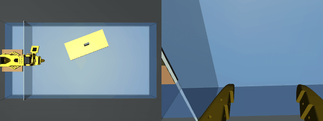
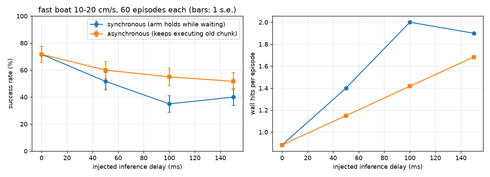

# ACT on the intercept task: camera-only policy, deployment and latency study

A vision-only ACT policy (Action Chunking with Transformers, LeRobot 0.7.1) is trained to do the
intercept step of the reset station: grasp the mast of a drifting boat with the SO-101 arm.
It sees two 240×320 camera images (overhead and wrist) and the six joint angles. It does not get the
boat pose, the AprilTag measurements or the Kalman filter that the stage-9 SAC policy uses.

The SAC policy acts as the teacher. The trained network is then exported to ONNX, run with
ONNX Runtime and TensorRT, profiled, and tested in closed loop with injected inference delay.

Everything runs in simulation (MuJoCo, 20 Hz control, 50 ms per step) on a GTX 1080 Ti under WSL2.



## Results

### Task success

Protocol of `eval/intercept_ab.py`: six speed bins, 30 episodes each (seeds 0–29), stage-9 conditions
(occlusion, two tags, action filter 0.8).

| Boat speed | Scripted | SAC teacher | ACT, imitation only | ACT + one DAgger round |
|---|---|---|---|---|
| 0 cm/s | 30 | 28 | 27 | 26 |
| 0–3 cm/s | 30 | 30 | 26 | 29 |
| 3–6 cm/s | 29 | 30 | 28 | 27 |
| 6–10 cm/s | 27 | 30 | 20 | 26 |
| 10–15 cm/s | 19 | 30 | 17 | 26 |
| 15–20 cm/s | 21 | 29 | 17 | 20 |
| **Total (of 180)** | **156 (86.7 %)** | **177 (98.3 %)** | **135 (75.0 %)** | **154 (85.6 %)** |
| Wall hits per episode | 0.52 | 0.10 | 0.44 | 0.33 |

Scripted and teacher use the privileged boat estimate; ACT uses images only.

Three things mattered:

1. **Re-planning rate.** ACT predicts 20 actions per inference. Executing 5 of them before looking again
   (250 ms) gave 66.1 %; re-planning every step (50 ms) gave 75.0 % with the same weights.
   This is possible because one inference takes less than one control period.
2. **DAgger.** Pure imitation got worse with more training (66.1 % at 30k steps, 53.3 % at 60k, 5-step execution)
   although the training loss kept falling. 160 extra episodes in which ACT drives 70 % of the time and the
   teacher labels every step, then 30k more steps from the 30k checkpoint, raised it to 85.6 %.
3. **Episode length when comparing to a reference.** On the official ALOHA transfer-cube ACT my loop first gave 56 %
   against 76 % from `lerobot-eval`. The cause was the gym-aloha default of 300 steps per episode; the official
   evaluation uses 400. With 400 steps: 84 % for both PyTorch and ONNX Runtime.

### Second DAgger round, aimed at fast boats

160 more DAgger episodes, 120 of them with boats at 10–20 cm/s, plus 100 teacher demonstrations of fast boats;
all data merged (820 episodes), training continued from the model above (`act/dagger2.sh`).

| Checkpoint | Seeds 0–29 | Fresh seeds 1000–1029 |
|---|---|---|
| After round 1 | 154/180 (85.6 %) | – |
| Round 2, + 10 000 steps | 164/180 (91.1 %) | 160/180 (88.9 %) |
| Round 2, + 20 000 steps | 139/180 (77.2 %) | – |

Together 324/360 (90.0 %) for the 10 000-step checkpoint; the fresh seeds were never used to choose it.
The fastest bin goes from 20/30 to 25/30 and 28/30. The second checkpoint of the same run is 14 points worse
although its training loss is lower, so the checkpoint has to be chosen by closed-loop evaluation.
The same pipeline with SmolVLA is in [`vla/`](../vla/README.md).

### Inference latency

Same input frame, 20 warm-up and 200 timed runs, GPU otherwise idle. Network only (no pre/post-processing).

| Model | PyTorch | ONNX Runtime (CUDA) | TensorRT 8.6.1 FP32 | TensorRT 8.6.1 FP16 |
|---|---|---|---|---|
| Intercept ACT (2 × 240×320, 20 actions) | 15.1 ms (p95 21.4) | 6.4 ms (p95 6.7) | 6.2 ms (p95 6.8) | 6.4 ms (p95 7.0) |
| Official ALOHA ACT (1 × 480×640, 100 actions) | 11.8 ms (p95 16.8) | 7.2 ms (p95 7.6) | 7.7 ms (p95 8.2) | 7.6 ms (p95 8.1) |

Maximum absolute difference to the PyTorch output: ONNX Runtime 2.0e-06, TensorRT 1.7e-06.

Closed loop with the ONNX Runtime backend: 155/180 (86.1 %), PyTorch 154/180 (85.6 %).

Pre-processing takes about 2 ms and post-processing 0.4 ms per inference, so the whole
image-to-action path fits in the 50 ms control period with a wide margin.

### C++ runtime with CUDA pre-processing (`act/cpp/`)

A stand-alone C++ program without Python or PyTorch: raw camera frames (uint8, HWC) are copied to the GPU from
pinned memory, a CUDA kernel normalises them and converts to CHW, TensorRT runs the engine on the same
CUDA stream, and the 20×5 action chunk is copied back and de-normalised.

| Stage (300 runs, GPU idle) | Mean | p95 |
|---|---|---|
| Upload two frames + CUDA pre-processing | 0.16 ms | 0.22 ms |
| TensorRT inference | 5.29 ms | 5.72 ms |
| Download + de-normalise | 0.06 ms | 0.09 ms |
| **Raw frames → actions, one synchronisation at the end** | **5.57 ms** | **6.09 ms** |

Maximum difference to the Python pipeline: 3.6e-07 after pre-processing, 9.7e-07 on the final actions.
The same path in Python (LeRobot pre-processing, PyTorch, post-processing) takes about 17.5 ms.
The same pre-processing on one CPU thread takes 0.33 ms, so at this image size the gain of the GPU kernel
itself is small; the point is that the frames never leave the GPU between upload and inference.

### Where the time goes (PyTorch, `act/profile_torch.py`)

| Module | Share of one inference |
|---|---|
| ResNet-18 backbone (two cameras) | 54 % |
| Transformer encoder | 20 % |
| Transformer decoder | 8 % |
| Rest | 18 % |

By operator, convolution accounts for 50 % of GPU time and linear layers for 31 %.
GPU kernels add up to about 12 ms per inference while the wall time was about 25 ms in that run
(the GPU was shared with a training job), which is the per-operator dispatch overhead that the
graph runtimes remove.

### Inference delay and execution mode

Fast boats (10–20 cm/s), 60 episodes per setting, 4 actions executed per inference.
Synchronous: the arm holds (zero action) while waiting for the result. Asynchronous: inference starts early,
the arm keeps executing the old chunk and the stale first actions of the new chunk are skipped.

| Injected delay | Synchronous | Asynchronous |
|---|---|---|
| 0 ms | 71.7 % | – |
| 50 ms | 51.7 % | 60.0 % |
| 100 ms | 35.0 % | 55.0 % |
| 150 ms | 40.0 % | 51.7 % |



One extra control period of delay costs about 20 points with synchronous execution. Asynchronous execution
keeps the loss to 12–20 points up to 150 ms. With 60 episodes one standard error is about 6 points,
so the difference between 35 % and 40 % is not meaningful.

## Limitations

- Simulation only. Rendering is software EGL on the CPU; camera latency and image noise are not modelled.
- The final checkpoint was chosen among three (80.0 %, 79.4 %, 85.6 %) on the same evaluation episodes,
  so 85.6 % is optimistic. 80–86 % is the honest range.
- One DAgger round with one seed. The fastest bin (15–20 cm/s) is still at 20/30.
- The KL term of the ACT loss fell to zero after about 18k steps: the teacher is deterministic, so the
  latent variable carries no information and training is effectively L1 regression.
- TensorRT: the GTX 1080 Ti (Pascal) is rejected by TensorRT 10 and 11. 8.6.1 works in a separate
  Python 3.10 environment with cuDNN 8 after constant folding of the exported graph. FP16 gives no speed-up on this card.
- Latency was measured on a desktop GPU. The C++ runtime processes one recorded frame; it is not yet connected
  to the simulator or to ROS 2, and there is no embedded target.

## Files

| File | Purpose |
|---|---|
| `common.py` | environment with stage-9 settings, camera rendering, joint readout, teacher path, speed bins |
| `add_camera.sh`, `render_check.py` | add the overhead camera to the scene; save test renders |
| `collect_demos.py`, `collect_full.sh` | teacher roll-outs, successful episodes saved as npz (images, joints, teacher action) |
| `replay_check.py` | replay recorded actions to confirm the data reproduces the episode |
| `convert_to_lerobot.py` | npz episodes → LeRobot dataset (images, 20 fps) |
| `train.sh` | `lerobot-train` with chunk size 20 |
| `collect_dagger.py`, `dagger_collect.sh`, `dagger_train.sh` | DAgger data, merge, continue training from a checkpoint |
| `eval_act.py` | closed-loop evaluation; PyTorch or ONNX backend, steps per inference, injected delay, sync/async |
| `eval_ckpts.sh`, `exec_ablation.sh`, `delay_sweep.sh`, `plot_delay.py` | checkpoint comparison, ablation, delay experiment |
| `export_onnx.py` | export the network (inputs `top`, `wrist`, `state`), compare with PyTorch |
| `trt_rs.sh`, `trt_data.py`, `trt_bench.py` | constant folding, TensorRT FP32/FP16 engines, numeric check, timing |
| `bench_torch_ort.py`, `profile_torch.py` | PyTorch and ONNX Runtime timing; per-module and per-operator profile |
| `dump_raw_sample.py` | one raw frame, normalisation constants and Python reference output as binary files for the C++ program |
| `cpp/preprocess.cu`, `cpp/main.cpp` | CUDA pre-processing kernel; C++ TensorRT inference with numeric check and timing |
| `cpp/install_tools.sh`, `cpp/build_run.sh` | nvcc, g++ 13 and TensorRT headers without root; build and run |
| `make_visuals.py`, `plot_loss.py` | loss curve, dataset samples, episode recordings |

## Reproduce

Needs LeRobot 0.7.1, PyTorch with CUDA, `onnxruntime-gpu==1.22.0`, stable-baselines3. Run from the repository root
with `PYTHONPATH=act` and `MUJOCO_GL=egl`.

```bash
bash act/add_camera.sh
bash act/collect_full.sh                                   # 300 episodes, all speeds
python act/collect_demos.py --v_max 0.0 --episodes 100 --out data/raw_static
python act/convert_to_lerobot.py data/raw_static data/raw_full_* data/lerobot_all
bash act/train.sh lerobot_all act_full 30000 10000
bash act/dagger_collect.sh outputs/act_full/checkpoints/last/pretrained_model d1 40000
bash act/dagger_train.sh outputs/act_full/checkpoints/030000/pretrained_model lerobot_d1 act_d1 30000 \
     data/raw_static data/raw_full_* data/raw_d1_*
python act/eval_act.py outputs/act_d1/checkpoints/030000/pretrained_model --bins --exec_steps 1
python act/export_onnx.py outputs/act_d1/checkpoints/030000/pretrained_model outputs/deploy_final
bash act/trt_rs.sh deploy_final
bash act/delay_sweep.sh outputs/act_d1/checkpoints/030000/pretrained_model 60
```

In this work the DAgger data was collected with the 60k-step imitation model and training continued from the 30k checkpoint.
