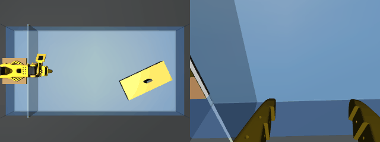

# SmolVLA on the intercept task: fine-tuning, execution strategy and TensorRT

The same intercept task as in [`act/`](../act/README.md), learned with SmolVLA (LeRobot 0.7.1, 450 M parameters)
instead of ACT. The base model `lerobot/smolvla_base` is fine-tuned on teacher demonstrations, improved with
two DAgger rounds, and then deployed: the whole inference (image resizing, vision-language model, three
flow-matching steps) is exported to ONNX and compiled to a TensorRT engine that drives the arm in closed loop.

Training and evaluation ran on an RTX 4090. Protocol, teacher, cameras and action space are those of the ACT
experiment: six speed bins × 30 episodes, 20 Hz control (50 ms per step).

## Results

### ACT and SmolVLA, same pipeline

| | ACT (52 M, GTX 1080 Ti) | SmolVLA (450 M, RTX 4090) |
|---|---|---|
| Imitation only, 400 teacher episodes | 135/180 (75.0 %) | 122/180 (67.8 %) |
| + one DAgger round, 160 episodes | 154/180 (85.6 %) | 139/180 (77.2 %) |
| + second DAgger round, biased to fast boats | – | 314/360 (87.2 %) |
| Final model as TensorRT engine, closed loop | – | 314/360 (87.2 %) |
| Trained parameters | all | 100 M (action expert), VLM frozen |
| Inference, PyTorch | 15.1 ms | 74.4 ms (10 steps), 32.1 ms (3 steps) |
| Inference, TensorRT | 6.2 ms | 16.5 ms (3 steps) |
| Actions predicted per inference | 20 | 50 |

Both use re-planning at every control step. SmolVLA numbers are with 3 flow-matching steps.
The demonstrations were collected separately for the two models (same teacher, same settings and seeds,
different machines), so the two datasets are not frame-identical.

Per speed bin, final models:

| Boat speed | ACT, 1 DAgger round | SmolVLA, 1 round | SmolVLA, 2 rounds | SmolVLA, 2 rounds, TensorRT engine |
|---|---|---|---|---|
| 0 cm/s | 26 | 28 | 27 | 24 |
| 0–3 cm/s | 29 | 25 | 27 | 28 |
| 3–6 cm/s | 27 | 25 | 26 | 26 |
| 6–10 cm/s | 26 | 25 | 25 | 26 |
| 10–15 cm/s | 26 | 23 | 29 | 29 |
| 15–20 cm/s | 20 | 13 | 23 | 27 |
| Total (of 180, seeds 0–29) | 154 | 139 | 157 | 160 |
| Total on fresh seeds 1000–1029 | – | – | 157 | 154 |

The fresh seeds were never used to choose a checkpoint.

### Fine-tuning curve

Success with 5 executed actions per inference, 10 flow-matching steps, inference time not counted:

| Training steps | 2 500 | 5 000 | 7 500 | 10 000 | 15 000 | 20 000 |
|---|---|---|---|---|---|---|
| Success | 38.9 % | 48.3 % | 55.0 % | 58.3 % | 54.4 % | 55.0 % |

Batch size 64, about 1.9 steps/s, 15 GB of GPU memory. After 10 000 steps the success rate stays flat while the
training loss keeps falling (0.50 → 0.24), the same pattern as with ACT.

### How many actions to execute per inference

10 000-step model, 10 flow-matching steps, inference time not counted:

| Executed actions per inference | 2 | 5 | 10 | 25 | 50 |
|---|---|---|---|---|---|
| Success | 65.6 % | 58.3 % | 45.0 % | 34.4 % | 34.4 % |

Executing the whole 50-action chunk (2.5 s without looking) halves the success rate. For a moving target the
re-planning rate matters more than anything else that was varied here.

### Fewer flow-matching steps buy a higher re-planning rate

Inference time on the RTX 4090 is 13.8 ms for the prefix (images, instruction, state; computed once) plus
6.1 ms per flow-matching step. With the default 10 steps this is 74 ms, more than one control period,
so re-planning at every step is not possible.

| Flow-matching steps | Inference (PyTorch) | Success, 5 actions per inference | Success, re-plan every step |
|---|---|---|---|
| 10 | 74.4 ms | 58.3 % | not feasible (> 50 ms) |
| 5 | 44.2 ms | 53.9 % | 61.7 % |
| 3 | 32.1 ms | 53.3 % | 65.6 % |

(10 000-step model.) Cutting the steps from 10 to 3 costs a few points at a fixed execution horizon, which is
within the noise of 180 episodes, and makes per-step re-planning possible, which gains about 12 points.
With the default 10 steps and the real 74 ms latency (one control period of delay): synchronous execution with
5 actions 53.9 %, asynchronous with 5 actions 50.0 %, asynchronous with 3 actions 58.9 %.

### DAgger

160 episodes in which SmolVLA drives 70 % of the time and the teacher labels every step, merged with the
400 demonstrations, 5 000 further training steps from the 20 000-step model:

| | Success (3 steps, re-plan every step) |
|---|---|
| Before DAgger | 122/180 (67.8 %) |
| + 2 500 steps | 132/180 (73.3 %) |
| + 5 000 steps | 139/180 (77.2 %) |

The gain (+9.4 points) is almost the same as for ACT (+10.6).

Second round, aimed at the failures: 160 more DAgger episodes, 120 of them with fast boats (10–20 cm/s), plus
100 teacher demonstrations of fast boats; all data merged (820 episodes, 54 607 frames), 5 000 further steps:

| | Seeds 0–29 | Fresh seeds 1000–1029 |
|---|---|---|
| After round 1 | 139/180 (77.2 %) | – |
| Round 2, + 2 500 steps | 149/180 (82.8 %) | – |
| Round 2, + 5 000 steps | 157/180 (87.2 %) | 157/180 (87.2 %) |

The fastest bin goes from 13/30 to 23/30. From 67.8 % to 87.2 % nothing changed in the model or the training
recipe; only the data did.

### Export and TensorRT

Final model (two DAgger rounds), 3 flow-matching steps unrolled into the graph, random noise as an explicit input.
Same input, GPU idle:

| Runtime | Inference | Max. difference to PyTorch (float32) |
|---|---|---|
| PyTorch, VLM in bfloat16 (as trained) | 32.3 ms | – |
| ONNX Runtime 1.32, CUDA | 50.6 ms | 5.1e-03 |
| TensorRT 11.5, FP32 | 16.6 ms | 6.2e-03 |

Closed loop, re-planning at every step, 180 episodes on seeds 0–29 and 180 on fresh seeds 1000–1029:

| Policy runs as | Seeds 0–29 | Seeds 1000–1029 | Together | Image → action |
|---|---|---|---|---|
| PyTorch, VLM in bfloat16 | 157/180 | 157/180 | 314/360 (87.2 %) | about 33 ms |
| TensorRT engine | 160/180 | 154/180 | 314/360 (87.2 %) | 16.8 ms |

On the model after the first DAgger round the same check gave 139/180 (PyTorch), 146/180 (PyTorch converted to
float32) and 134/180 (TensorRT engine).

What had to be solved:

- The VLM weights are loaded in bfloat16, which ONNX Runtime does not accept. The model is converted to float32
  before export. This changes the output by up to 0.1 (actions are in about ±2), so numerical closeness to the
  trained model cannot be claimed and the closed-loop runs above are the check.
- PyTorch ships CUDA 13 libraries, ONNX Runtime needs its own. ONNX Runtime and the TensorRT builder live in a
  separate environment so that the training environment is not touched.
- ONNX Runtime is slower than PyTorch on this graph (more than 200 `ScatterND` nodes), unlike for ACT where it
  was as fast as TensorRT. Which runtime is fastest has to be measured per model.
- TensorRT 11 no longer has the FP16 builder flag; a half-precision engine would need a float16 ONNX model.
  Not done. `torch.autocast` to float16 made PyTorch slower (85 ms against 74 ms).

## Limitations

- Closed-loop numbers of 180 episodes have a standard error of about 3 points, and every run draws different
  random noise for the flow-matching start. Differences such as 154 against 160 are not meaningful.
- One training run. The execution studies were done on the 10 000-step model and their checkpoints were not
  selected on separate episodes; only the final model was also evaluated on fresh seeds.
- The ACT model has had one DAgger round and SmolVLA two, so the last rows of the comparison are not like for like.
- Simulation only. The execution studies count inference below 50 ms as no delay, as in the ACT experiments.
- Only the default fine-tuning mode was used (action expert trained, VLM frozen), with 240×320 images that the
  model pads to 512×512. Unfreezing the VLM or training at higher resolution was not tried.
- SmolVLA is slower and less successful than ACT here. The task is a single short skill with one instruction,
  which does not use what a VLA adds (language, many tasks in one model).

## Files

| File | Purpose |
|---|---|
| `setup_remote.sh` | user-level environment on a server without access to GitHub or huggingface.co (mirrors) |
| `convert_vla.py` | teacher episodes → LeRobot dataset with cameras `camera1`, `camera2` and a task string |
| `train_vla.sh` | `lerobot-train` from `lerobot/smolvla_base` or from an own checkpoint |
| `eval_vla.py` | closed-loop evaluation: executed actions per inference, flow-matching steps, delay, sync/async, float32, TensorRT backend |
| `par_eval.sh`, `cfg_*.txt` | several evaluations with limited parallelism and low priority (shared server) |
| `collect_dagger_vla.py`, `dagger_vla.sh`, `dagger_vla2.sh` | DAgger data, merge, continue training, evaluate (round 1; round 2 biased to fast boats) |
| `make_gif_vla.py` | record an episode from both cameras |
| `bench_vla.py` | inference time against number of flow-matching steps, split into prefix and per-step cost |
| `export_vla.py` | export the full inference to ONNX, compare with PyTorch |
| `ort_trt_bench.py` | ONNX Runtime timing, TensorRT engine build and timing (separate environment) |
| `final_vla.sh` | timing, export, engine build and closed-loop checks for the final model |

Run from the repository root with `PYTHONPATH=act`; the environment and the teacher are those of `act/`.
